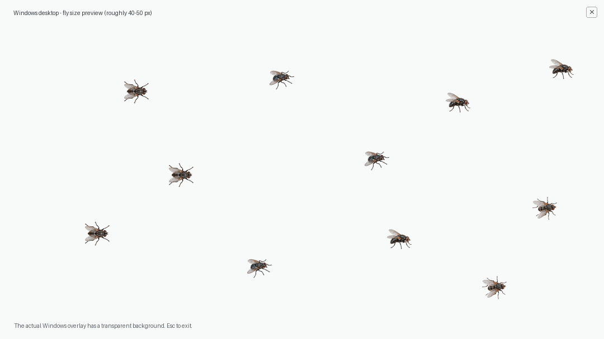

# TinyScreenFlies 🪰

**一个轻量的 Windows 桌面苍蝇恶作剧：几只逼真的小苍蝇会在桌面和其他窗口上爬行、搓前腿、飞行，伴随轻微的嗡嗡振翅声。**

A tiny, playful Windows desktop overlay with realistic flies that crawl, groom and fly across the screen, complete with dynamically synthesized buzzing sound.



> 截图是效果示意。实际程序使用透明背景，将苍蝇叠加在 Windows 桌面和其他窗口上。

## 功能

- 🪰 **逼真的小苍蝇**：4 种透明背景图片，随机混合显示，大小约 40–50 物理像素。
- 🐾 **自然运动**：随机爬行、短暂停留、搓前腿和快速飞行。
- 🔊 **动态振翅音效**：多只苍蝇飞行时嗡嗡声随数量略增，落地后渐弱；音量经过限制，避免突然爆响。
- 🎵 **一键静音**：点击右上角的 20×20 像素 `♪` 按钮，或按 `M` 键切换静音；按钮变成 `M` 代表已经静音。
- 🖱️ **鼠标穿透**：苍蝇贴图不会阻挡正常操作。
- ❎ **迷你退出按钮**：右上角 20×20 像素「×」；也可以随时按 `Esc` 退出。
- ⏳ **自动退出**：运行 3 分钟后自动结束。
- 🔒 **无联网、无安装**：单个 Windows `.exe`，无第三方运行时依赖，不修改开机启动项。

## 直接使用

1. 下载仓库中的 [`苍蝇爬屏幕.exe`](苍蝇爬屏幕.exe)（或者下载整个项目 ZIP）。
2. 在 **Windows 10/11（64 位）** 电脑上双击运行。
3. 默认播放轻微振翅声；点击右上角小 `♪` 或按 `M` 可静音／取消静音。
4. 按 `Esc` 或点击屏幕右上角的极小「×」即可退出。

**友情提示**：仅在对方知情或愿意参与恶作剧的情况下分享。下载文件本身不会自动运行，收件人必须主动打开。Windows 对无数字签名的程序可能出现安全提示；请先检查源码和文件来源，不建议绕过系统安全防护。

## 从源码构建

需要 [Go](https://go.dev/dl/) 1.21 或更高版本。仅使用 Go 标准库与 Windows 系统 API（`user32.dll`、`gdi32.dll`、`winmm.dll`），不需要额外安装音频播放器或下载音频素材。音效由程序在内存中实时合成，声音仅影响当前进程，不更改系统音量。

在 Windows PowerShell 中：

```powershell
go build -ldflags="-H=windowsgui -s -w" -o "苍蝇爬屏幕.exe" .
```

在 Linux/macOS 下交叉编译 Windows 64 位版本：

```bash
GOOS=windows GOARCH=amd64 CGO_ENABLED=0 go build -ldflags='-H=windowsgui -s -w' -o '苍蝇爬屏幕.exe' .
```

或者在 Windows 中执行 [`build.bat`](build.bat)。

## 自定义

在 `main.go` 中修改：

| 选项 | 当前位置 | 默认值 |
| --- | --- | --- |
| 苍蝇数量 | `flyCount` | `13` |
| 苍蝇大小 | `newFly(…)` 的尺寸参数 | `40 + rng.Float64()*10`（40–50 px） |
| 自动退出时间 | `maxDuration` | `180 * time.Second` |
| 关闭按钮尺寸 | `btnW, btnH` | `20, 20` px |
| 音效强度、振翅频率 | `audio_windows.go` 的 `buzzSynth.fill` | 柔和、实时变化 |
| 静音热键 | `main.go` 中的 `vkM` | `M` |

四种苍蝇图片位于 `assets/fly1.png` 至 `assets/fly4.png`，构建时通过 `go:embed` 打包进 `.exe`，分享时无需额外携带图片文件。

## 项目文件

```text
TinyScreenFlies/
├── README.md                # 项目介绍
├── main.go                  # Windows 透明置顶窗口和苍蝇行为逻辑
├── audio_windows.go         # 实时合成苍蝇振翅音效（WinMM）
├── go.mod                   # Go 模块
├── build.bat                # Windows 编译脚本
├── assets/                  # 四种真实苍蝇透明 PNG
│   ├── fly1.png
│   ├── fly2.png
│   ├── fly3.png
│   └── fly4.png
├── 效果预览.png              # 截图示意
├── 音效试听.wav              # 简短音效预览（程序运行不依赖此文件）
└── 苍蝇爬屏幕.exe            # 预编译 Windows 64 位程序
```

## 说明

- PNG 素材来自本项目创作过程的 AI 辅助生成与整理。
- 当前发布包含源码与预编译程序。程序已完成交叉编译和静态文件格式检查，**未在真实 Windows 桌面完成运行及声卡播放验证**。
- 这是娱乐用途的轻量程序，不提供隐蔽运行、自启动、持久化或远程控制功能。
- 仓库公开并不意味着已经授予他人重用或再分发代码的许可证；如需开源许可证，可由仓库所有者另行添加。
